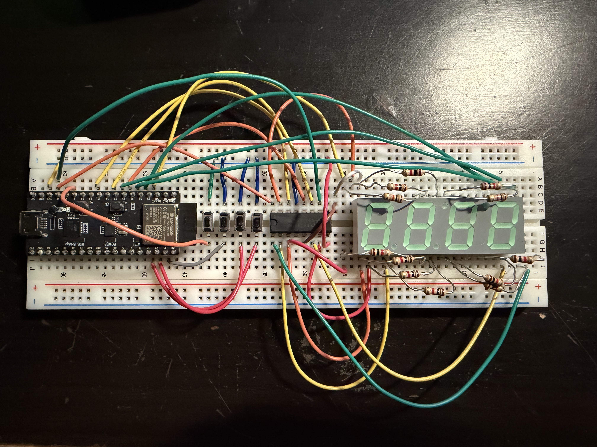

# EGEC 450 - Lab Files

EGEC 450 Course: In this course, we are learning interfacing techniques based on speed, timings, synchronization, interrupts, protocols, noise, and race conditions. As well as, interfacing specifications of the processor data, address and control buses.

## Lab 3: Interrupt-Driven Stopwatch

